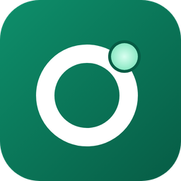
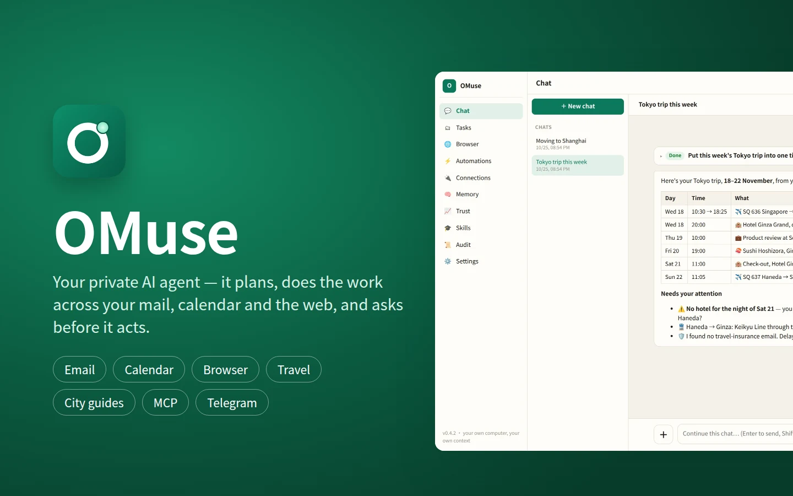

<p align="center"></p>

<h1 align="center">OMuse</h1>
<p align="center"><b>Your private AI agent that lives on your Olares — and asks before it acts.</b></p>



OMuse is a local-first AI agent. It doesn't just chat: it turns a request into a plan and carries it out across your
email, calendar, Google Drive, Notion, Slack and the web. Anything that sends, posts, pays or deletes waits for your
approval.

OMuse is one Rust binary (`omuse`). How it is built inside — services, crates, policy, data layout, the card catalog and
other knowledge files — is in [KNOWLEDGE.md](KNOWLEDGE.md). Repository rules, tests and the release steps are in
[AGENTS.md](AGENTS.md).

## Features

- **Chat → plan → act** – every step and tool call is visible; independent steps run in parallel as sub-agents.
- **Bots** – the chat is split into bots, listed in the menu with **Main** at the top: Travel booking, City guides,
  Arrival & entry, Travel insurance & claims, Credit cards, Photos & videos. Each has its own skills and conversations; all share
  your memory, profile, Vault and connections, and shows a few example requests above the input. Ask Main anything: the planner model reads each request and either
  lets Main answer it or hands it, with the context from your conversation, to the right bot; then shows that bot's answer with a link to continue in the bot's conversation.
  An approval the bot needs shows in Main too.
- **Email** – several mailboxes (Gmail, Outlook / Hotmail, Yahoo, iCloud, QQ Mail, NetEase 163 / 126, Zoho, AOL, any
  IMAP / SMTP server): search, read, draft, reply, send, one-click unsubscribe. Sign-in codes and reset links are
  hidden from the model.
- **Calendar, Notion & Slack** – look things up, write reports, update boards, read and post messages.
- **Web browser** – its own Chromium with a live view; you take over for logins and CAPTCHAs.
- **Flights, hotels & restaurants** – `flights_search` works out of the box with Kiwi.com's flight data (free, information only: the booking happens on the airline's own site or with an agency you choose, never through Kiwi) and runs beside `web_search` for fares; a SerpApi key switches flights to Google Flights data and adds Google Hotels (`hotels_search`, `hotel_rooms`) and Google Maps places (`places_search`, `place_details`) for restaurants. That key serves these tools only, never web search. The travel skills search and compare there and open the browser only to book, on the provider's own site or the platform you name.
- **Web search** – one `web_search` tool on every model call: Exa's free MCP first, then Tavily, Brave or Exa keys, and the browser's own search engines as the last resort — one call returns titles, URLs and snippets, no search page and no CAPTCHA. Exa's public MCP server answers first with no key at all (rate-limited), so `web_search` works out of the box; keys are entered in Settings → Connections (several at once: tried in that order, the one that worked last first); a server can also ship default keys in `[search]`. 
- **MCP connectors** – plug in any MCP (Model Context Protocol) server.
- **Background work** – multi-day goals, event triggers (new email / Slack message / Notion change) and schedules, created from the chat and by skills (the Automations page is not in the navigation for now).
- **Telegram remote control** – give tasks and approve actions from your phone.
- **Research library** – in-depth Markdown reports you refine and refresh later.
- **Travel skills for Asia** – see [Travel use cases](#travel-use-cases) below.
- **Trip photos and videos** – the clips and photos of a trip in your Google Drive become a highlights video (join,
  cut, vertical for phones, title, music) or a photo story book PDF, edited on your own machine and put back in
  Drive; Drive clean-up before the next trip. One Google sign-in connects Calendar and Drive.
- **Memory, profile & skills** – the profile (name as in the passport, birthday, nationality, any number of addresses) can be filled from a photo of your ID; the number goes to the Vault, the photo is not kept. **English and Chinese UI**.

## Safe by design

- **Sentinel**, an independent guard, decides ALLOW / DENY / ASK for every action. Ordinary browser actions (page
  loads, clicks, typing, submits) are approved automatically by default and recorded like a manual approval
  (Settings → Agent turns that off). Vault values, uploads, payments, order changes, logins and anything after a
  suspected prompt injection always ask.
- **Vault**: passwords, tokens, passport and card numbers are encrypted in Sentinel; the model never sees them.
- **Prompt-injection defences**: mail, pages and tool output are untrusted.
- **Audit trail**: an append-only, hash-chained log of every model call, tool call, decision and approval.

## Travel use cases

Each use case is a skill (`skills/<name>/SKILL.md`) the agent loads when your request matches. They share four rules:
data sources before the browser (mail, calendar, the travel data connector, market data, official pages read without
clicking); **the passport and card numbers come only from the Vault**, filled into a form with your approval and never
shown in chat; **you submit legal declarations yourself** (the agent fills the form and hands you the browser on a
takeover card); and whatever you tell it is proposed for your profile or memory so you are not asked twice (a passport
photo is read once and not kept).

| Use case | Ask for example | What OMuse does | Skill |
|---|---|---|---|
| **Today on the trip** | "What do I have today in Tokyo?" | Pulls flights, hotels, tables and meetings from mail and calendar into one timeline; flags a night without a hotel, a missing transfer, a meeting before landing; reminds you about travel insurance. | `trip-today` |
| **Which arrival cards** | "What do I need to file for Bangkok then Seoul?" | Lists every card / authorisation the trip needs by passport, when each window opens, sets reminders, calls the country skill. | `arrival-cards` |
| **Fill an arrival card** | "Fill in my Singapore arrival card" | Flight and hotel from mail (or calendar / memory; with no mailbox it asks once, or reads an uploaded e-ticket), identity from the profile (the profile holds any number of addresses: the one in the destination country is used, and you are asked to choose when there are several), passport from the Vault; fills the official form and hands you the Submit. Too early → a reminder for the day the window opens. | `sg-arrival-card`, `th-arrival-card`, `my-arrival-card`, `kr-arrival-card`, `jp-visit-japan-web`, `cn-arrival-card`, `tw-arrival-card`, `id-arrival-card`, `ph-etravel`, `kh-arrival-card`, `uk-eta` |
| **EU entry** | "Do I need ETIAS for Paris?" | Reads the official status page: EES needs no form; ETIAS is not live yet (announced for 2027) and any site selling it is a scam. | `eu-etias` |
| **Entry requirements** | "Visa, passport validity and customs for Vietnam?" | Visa / visa-free rules, passport validity, medication and customs limits from official pages, with the date checked and reminders. | `entry-requirements` |
| **Flight disrupted** | "My flight SQ 638 is delayed, what now?" | Live status, rebooking options from the data connector, what the airline and local rules owe you, the proof an insurance claim needs, a watch until departure. | `flight-disruption` |
| **Get the money back** | "I got sick and missed my flight booked on my Sapphire Reserve — claim the insurance" | Trip cancellation / interruption claim on the Chase Sapphire card: which benefit, the 20-day and 90-day clocks with dates, the airline refund and letter first, the physician statement, the claim started on the administrator's portal (you sign in and press Submit), a claim packet PDF and reminders until it is paid. | `csr-trip-claim` |
| **Travel insurance** | "Buy FWD travel insurance for my Tokyo trip" · "Claim my FWD insurance for the delayed flight" | FWD Singapore and Hong Kong: quote and compare plans, fill the application (passport and card from the Vault) and hand it over for you to pay; claims from your mail — Singapore on FWD's claim form (you press Submit), Hong Kong on bolttech's claim form, filled and attached to an email draft (you add your HKID, bank account and signature). | `fwd-travel-insurance` |
| **Bag delayed or lost** | "My suitcase didn't arrive in Narita" | The PIR before you leave the airport, tracking, keeping essentials receipts, the 21-day rule and Montreal limits, claim drafts to the airline and the insurer. | `baggage-delayed-lost` |
| **Hotel requests** | "Ask the hotel for a late check-out" | Booking from mail, free-cancellation deadline, an email draft or a call; reconfirmation the day before. | `hotel-requests` |
| **Payments and getting online** | "How do I pay in Tokyo and Shanghai?" | Wallets with foreign cards (Alipay / WeChat Pay set-up before departure), transit cards, cash, rates from market data, avoiding dynamic currency conversion, eSIMs. | `payments-connectivity-asia` |
| **Getting around** | "Airport to Myeongdong, and is the JR Pass worth it?" | Airport transfers, metros and IC cards, high-speed rail tickets (12306 passport registration), rail-pass maths, ride-hailing apps, typhoon and holiday effects. | `getting-around-asia` |
| **Tax refunds** | "How does the tax refund work in Japan now?" | Japan's refund at departure from 1 November 2026, Korea, Singapore eTRS, Thailand, Taiwan: thresholds, paperwork, airport steps and a departure-day reminder. | `tax-refund-shopping` |
| **Food and language** | "Make me a peanut-allergy card in Japanese" + a menu photo | Dietary cards in the local language; menus and signs translated with the vision model; table customs. | `dining-dietary-translate` |
| **Emergencies** | "I lost my passport in Seoul" | Police report, consulate and emergency travel document; English-speaking hospitals; the insurer's assistance line; emergency numbers and alerts. | `travel-health-emergency` |
| **Trip highlights video** | "Join the clips from my Kyoto trip, add a title and make it vertical for Instagram" | Finds the clips in your Google Drive, downloads them and edits locally with ffmpeg (join, cut, resize, caption, music, speed, mute), shows the cut in the chat and puts it back in the trip folder with your approval. | `drive-video-edit` |
| **Trip photo story book** | "Make a story book from our Kyoto photos for the kids" | Picks and orders the trip photos from Drive, restyles or captions them where asked, writes the story or captions, lays out a PDF, shows it and uploads it next to the photos. | `drive-photo-storybook` |
| **Room for the next trip** | "My Drive is full — what can go?" | Lists the large and long-unused files (old backups, raw footage) with size and last-opened date, you pick, and one approved step moves them to the bin — never a permanent delete. | `drive-cleanup` |
| **Expense report** | "Build the expense report for my Tokyo trip" + receipts | Receipts from mail, uploaded card statements and photographed paper receipts (read by the vision model), de-duplicated, converted at the transaction-date rate, an Excel ledger and a PDF claim. | `travel-expense-report` |
| **Which card to use** | "Which card for this ¥30,000 dinner?" | Your cards from the profile (names only) against a 160-card terms catalog: value per card, the best pick, caveats and the date the terms were verified. Updating the catalog: [KNOWLEDGE.md](KNOWLEDGE.md). | `credit-card-picker` |
| **City guides** | "I'm moving to Shanghai for work — where do expats live and what does it cost?" | Briefings for Westerners on Beijing, Shanghai, Shenzhen, Guangzhou, Chengdu, Tokyo, Osaka, Seoul, Singapore, Hong Kong, Taipei, Bangkok, Kuala Lumpur, Ho Chi Minh City and Hanoi: entry and airports, money and apps, getting around, business customs, neighbourhoods and costs, health and schools, food, sights. Answers come from the guide's dated facts and data tools (exchange rates, the travel connector), never the browser. | `beijing`, `shanghai`, `shenzhen`, `guangzhou`, `chengdu`, `tokyo`, `osaka`, `seoul`, `singapore`, `hong-kong`, `taipei`, `bangkok`, `kuala-lumpur`, `ho-chi-minh-city`, `hanoi` |
| **Plan and book** | "Flights to Tokyo next Friday, a hotel in Ginza, a 3-star dinner" | Flights, hotels, itineraries and restaurant bookings (existing skills). | `travel-planning`, `flight-booking`, `hotel-booking`, `restaurant-booking`, `michelin-dining` |

Connect a mailbox, a calendar and Google Drive (Settings → Connections; one Google sign-in covers Calendar and
Drive) and fill your profile (Memory → Profile: name as in the
passport, birthday, nationality; the passport number goes into the Vault) to get the most out of them.

## Build and run from source

You need a stable Rust toolchain (1.85 or newer) and, for the agent's browser, Chromium or Google Chrome.

```bash
git clone https://github.com/second-state/omuse && cd omuse
cargo build --release                       # → target/release/omuse (UI, skills and scripts are compiled in)
cp config.example.toml config.toml          # set the keys below
./target/release/omuse --config config.toml
```

In `config.toml` set at least:

```toml
[data]
dir = "./omuse-data"           # all state: sentinel/, runtime/, workspace/, browser-profile/

[auth]
password = "choose-a-long-password"

[model]
url = "https://api.openai.com/v1"   # any OpenAI-compatible endpoint
name = "gpt-4.1"
api_key = "sk-..."

[browser]
headless = "1"                 # no virtual display on a desktop machine
executable = ""                # "" = auto-detect Chromium / Chrome
```

`fast = true` sends `service_tier: "fast"` with every chat request and `reasoning_effort` (`none` … `xhigh`) sets the
reasoning effort, both in the OpenAI request format. They apply to the system's models; a user who brings their own
model (Settings → Models → "Use my own model") sets both there.

Open `http://localhost:8080` and sign in as `omuse` with that password, then change it in Settings → Password. The one
process runs the three services (Sentinel on 8080, the runtime and the browser broker on loopback); `--role
sentinel|runtime|browser` runs one of them for a split deployment. Keep `config.toml` out of git: it holds your password
and API key. Every key in `config.example.toml` is commented.

## Run with Docker

```bash
cp config.example.toml config.toml          # set [auth] password, [model] url / name / api_key, [server] timezone
docker build -t omuse .
docker run -d --name omuse --restart unless-stopped \
  -p 8080:8080 -v omuse-data:/omuse -v "$PWD/config.toml:/omuse/config.toml:ro" \
  omuse
```

The image carries the binary, Chromium and Xvfb, ffmpeg, `heif-convert` and Noto CJK fonts; state lives in the
`omuse-data` volume. After editing `config.toml`, `docker restart omuse`. Add `-p 8083:8083` only for the Telnyx phone
line. Before opening the port to the internet, put HTTPS in front (Cloudflare Tunnel, Tailscale Funnel, Caddy, …).
Without a password the container refuses to start (exit code 64).

Platforms that pass settings only as environment variables (Fly secrets, Products Provisioner) can leave the file out:
the entrypoint then writes the config from these variables. A mounted `config.toml` always wins.

| Section | Keys (environment variable without a config file) |
|---|---|
| `[auth]` | `password` (`OMUSE_PASSWORD`, required), `user` (`OMUSE_USER`), `enabled = false` (`OMUSE_AUTH=off`) |
| `[search]` | `tavily_key`, `brave_key`, `exa_key` (`OMUSE_TAVILY_KEY`, `OMUSE_BRAVE_KEY`, `OMUSE_EXA_KEY`): the server's default web-search keys, tried after Exa's free MCP (`free_exa`) in the order Tavily, Brave, Exa, the one that worked last first; `serpapi_key` (`OMUSE_SERPAPI_KEY`): the default key for flights, hotels and restaurants only. A key the user enters in Settings → Connections wins per provider, and the page says which keys come from the server |
| `[google]` | `auth_url`, `token_url`, `gcal_api`, `gdrive_api`, `gdrive_upload_api`, `relay_url`, the managed client (`GOOGLE_*`) |
| `[model]` | `url`, `name`, `api_key`, `planner`, `vision`, `stt`, `image`, `video` (`OMUSE_MODEL_URL`, `OMUSE_MODEL`, …), `fast` (`OMUSE_MODEL_FAST`), `reasoning_effort` (`OMUSE_MODEL_REASONING`); optional `image_url` / `image_api_key` and `video_url` / `video_api_key` when pictures or clips come from another provider (blank = the model endpoint and key) |
| `[server]` | `port`, `timezone` (`TZ`) |
| `[skills]` | `initial` (`OMUSE_SKILLS`), `dir` |
| `[browser]` | `headless` (`BROWSER_HEADLESS`), `executable`, `auto_approve` |
| `[telegram]`, `[voice]` | `enabled = false` (`TELEGRAM_BOT=0`), `port = 0` (`VOICE_PORT=0`) |
| `[stripe]` | `api_key`, `customer_id`, `subscription_id` (`OMUSE_STRIPE_*`) |

## Deploy on Fly.io

```bash
fly launch --no-deploy --copy-config        # once: creates the app
fly volumes create omuse_data --size 10     # once
fly secrets set OMUSE_PASSWORD='choose-a-long-password' OMUSE_MODEL_API_KEY=sk-...
fly deploy
```

`fly.toml` and `Dockerfile.fly` run the same binary on one always-on machine with one volume; keep it at one machine.

## Install on Olares

- **Olares Market**: search for *OMuse*.
- **Manual**: `sh chart/build.sh omuse`, then upload `dist/omuse-<version>.tgz` in Olares Market ▸ *Upload custom
  chart*. The pod runs the release image `ghcr.io/second-state/omuse:omuse-v<version>`.

The model endpoint defaults to `https://router.<your-olares-name>.olares.com/v1`; change it in Settings or with the
`OMUSE_MODEL_URL` / `OMUSE_MODEL` values of the app environment.

## Development and tests

```bash
cargo check --workspace
cargo test --workspace
cargo clippy --workspace -- -D warnings && cargo fmt --all -- --check
python3 tests/i18n_check.py                  # after any UI string change
```

For UI work, set `[web] dir = "web"` to serve the files from disk with hot reload; `[skills] dir` does the same for
skills.

The end-to-end suites in `tests/` (Python and Playwright) run the binary inside Docker against a scripted model and
fake third-party services, one fresh stack per suite. You need nothing on the host but Docker:

```bash
docker build -f Dockerfile.test -t omuse-test .   # rebuild after changing crates/, web/ or skills/
bash tests/run_in_docker.sh                        # every suite
bash tests/run_in_docker.sh sgac_e2e arrival_nomail_e2e   # only these
bash tests/docker_image_smoke.sh omuse             # the production image
```

Some suites also run with a real model: point `OMUSE_E2E_ENV_FILE` at a file **outside the repository** with the
endpoint, key and model names (see `tests/travel_common.py`); each prints a `TIMING` line that excludes model time.
